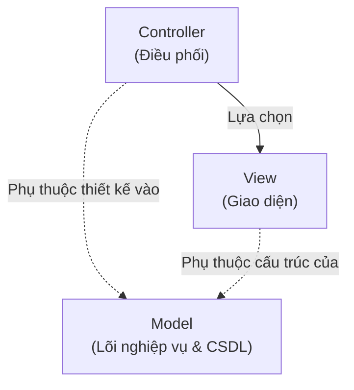
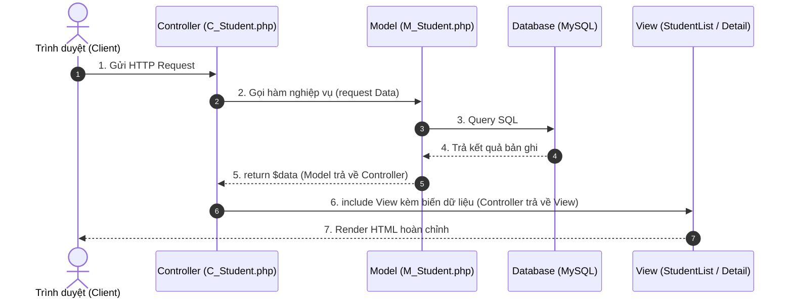

# Công nghệ Web - 29-10-2026
## Mô hình MVC trong PHP: Bản chất "Model quyết định Controller" & Luồng dữ liệu "Model -> Controller -> View"

Nguồn tài liệu: [Mô Hinh MVC-PHP.pdf](file:///D:/DuyToan/DUT/C%C3%B4ng%20ngh%E1%BB%87%20Web/T%C3%A0i%20Li%E1%BB%87u%20H%E1%BB%8Dc%20Ph%E1%BA%A7n/M%C3%B4%20Hinh%20MVC-PHP.pdf) (Slide 1 – Slide 30)

---

## I. Hai ý cốt lõi của thầy

### 1. "Model quyết định Controller" (Góc nhìn thiết kế kiến trúc - Slide 12)
* **Ẩn dụ:** Đầu máy đĩa (Model) quyết định Remote (Controller). Remote chỉ có các nút để bấm những chức năng đầu máy hỗ trợ; đổi đầu đĩa thì remote phải đổi theo.
* **Bản chất:**
  - Model chứa toàn bộ logic nghiệp vụ (Business Logic) và cấu trúc thực thể (Entity). Model độc lập, không phụ thuộc vào Controller.
  - Controller được thiết kế để kết nối và gọi Model.
  - Khi Model đổi hàm, đổi tham số hoặc đổi cấu trúc dữ liệu $\rightarrow$ Controller bắt buộc phải sửa theo.

### 2. "Model trả về Controller, Controller trả về View" (Góc nhìn luồng dữ liệu lúc chạy - Slide 15 & 16)
* **Luồng chạy:**
  1. `Client` gửi Request $\rightarrow$ `Controller` tiếp nhận và phân tích tham số (`$_GET`, `$_POST`).
  2. `Controller` gọi hàm xử lý của `Model`.
  3. `Model` truy vấn DB, đóng gói dữ liệu và **`return` kết quả về cho `Controller`**.
  4. `Controller` nhận kết quả, chọn View phù hợp rồi **`include` và truyền dữ liệu sang cho `View`**.
  5. `View` nhận biến từ Controller, nhúng vào HTML rồi trả kết quả hiển thị về Client.
* **Quy tắc:** Model không gửi thẳng cho View; View không tự gọi Model. Controller luôn đứng ở giữa làm trạm điều phối trung gian.

---

## II. Sơ đồ trực quan

### 1. Sơ đồ phụ thuộc kiến trúc (Design Dependency)


### 2. Sơ đồ tuần tự lúc chạy (Runtime Sequence)


---

## III. Code minh họa luồng (Gọn & Đúng chuẩn)

### 1. Model: `M_Student.php` (Truy vấn CSDL & `return` cho Controller)
```php
<?php
include_once("E_Student.php");

class Model_Student {
    public function getAllStudent() {
        $link = mysqli_connect("localhost", "root", "", "DULIEU");
        $rs = mysqli_query($link, "SELECT * FROM sinhvien");
        $students = [];
        while ($row = mysqli_fetch_array($rs)) {
            $students[$row['id']] = new Entity_Student($row['id'], $row['name'], $row['age'], $row['university']);
        }
        return $students; // Trả dữ liệu về Controller
    }

    public function getStudentDetail($stid) {
        $all = $this->getAllStudent();
        return $all[$stid] ?? null; // Trả dữ liệu về Controller
    }
}
?>
```

### 2. Controller: `C_Student.php` (Nhận từ Model $\rightarrow$ nạp View)
```php
<?php
include_once("../Model/M_Student.php");

class Ctrl_Student {
    public function invoke() {
        $model = new Model_Student();
        
        if (isset($_GET['stid'])) {
            $student = $model->getStudentDetail($_GET['stid']); // 1. Model trả về Controller
            include_once("../View/StudentDetail.html");           // 2. Controller trả về View
        } else {
            $studentList = $model->getAllStudent();             // 1. Model trả về Controller
            include_once("../View/StudentList.html");            // 2. Controller trả về View
        }
    }
}

(new Ctrl_Student())->invoke();
?>
```

### 3. View: `StudentList.html` (Chỉ dùng biến Controller truyền sang)
```html
<h2>Danh sách sinh viên:</h2>
<?php
foreach ($studentList as $st) {
    echo "<p><a href='?stid={$st->id}'>{$st->name}</a></p>";
}
?>
```

---

## IV. 7 Chú ý cốt lõi khi làm bài thi / đồ án
1. **CSDL độc quyền ở Model:** Mọi câu lệnh SQL chỉ viết trong Model. Cấm viết SQL trong Controller hay View.
2. **Controller là nhạc trưởng:** Chỉ nhận request, gọi Model, nhận dữ liệu và nạp View. Không tính toán nghiệp vụ phức tạp, không echo HTML.
3. **View thụ động:** Chỉ hiển thị biến do Controller đưa sang, cấm tự gọi Model.
4. **Không gọi trực tiếp file View:** Luôn truy cập qua URL của Controller hoặc `index.php`.
5. **Entity (Bean):** Dùng để đóng gói và vận chuyển dữ liệu chuẩn hóa giữa các tầng.
6. **Model dày - Controller mỏng:** Logic nghiệp vụ dồn hết vào Model.
7. **Độc lập:** Đổi giao diện chỉ sửa View; đổi CSDL chỉ sửa Model, các tầng khác giữ nguyên.

---

## V. Lời dặn nhanh của thầy
- **"Model quyết định Controller"**: Thiết kế Model trước, Controller viết theo Model.
- **"Model $\rightarrow$ Controller $\rightarrow$ View"**: Dữ liệu lúc chạy phải đi tuần tự qua Controller điều phối, không đi tắt đón đầu.
